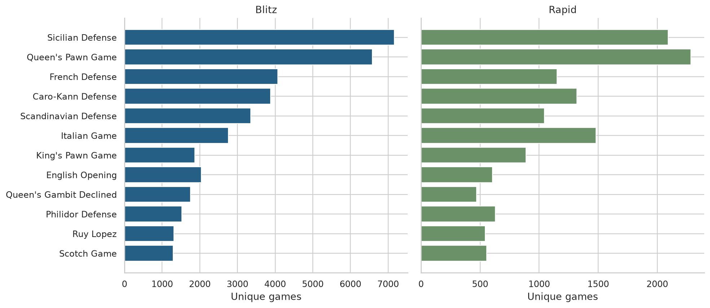
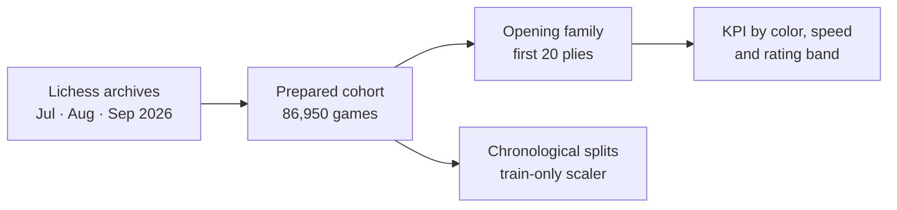

<div align="center">

# ♟️ Opening Outcomes for Training Planning

**Which openings should a club review first, and how do they actually score by color, speed and rating band?**


-2C7A4B)


Business Intelligence course project (IIB423T) · **Group 03**: Javier Alcaíno, Lucas Riquelme and Renato Varela

Repository: [github.com/red-nato/ChessOpenings](https://github.com/red-nato/ChessOpenings) · W2 submission: tag `W2`

</div>

---

## 📖 Background

This project started as an analysis of how resources are spent in public and subsidized private schools in La Cisterna, Chile. Because of the nature of the course, which needs a decision, a measurable KPI and observed data that can continue into prediction and a dashboard, the team moved to a new case. After a brief feasibility check of other public datasets (including Valorant), it settled on **chess openings**. The earlier school work is preserved in its original folder and repository and is not relabelled as chess work.

## 🎯 Question and KPI

A **club training coordinator** (a proposed user, not a validated one) needs to prioritise opening-review material. The analysis compares exposure and observed results **within color, speed and focal-player rating band**.

```text
KPI = (wins + 0.5 × draws) / eligible games     (in the specified cell)
```

> [!IMPORTANT]
> The KPI is descriptive. It is **not** a causal effect, a predictive accuracy, or a measure of training effectiveness. Scores are always read together with their denominators.

- One row is **one unique game**; a game is never split across train and evaluation sets.
- The opening is identified from the **first 20 plies** (right after Black's 10th move). Full-game opening tags, winners, post-game rating changes and termination are excluded from predictors.

## 📊 At a glance

| | |
|---|---|
| **Source** | Official Lichess standard-rated archives: July, August and September 2026 |
| **Eligible games** | 86,950 unique games (64,824 blitz · 22,126 rapid) |
| **Opening families** | 140 (most frequent: Sicilian Defense, 9,255 games) |
| **Chronological split** | July train (30,615) · August validation (25,782) · September test (30,553) |
| **W2 sample** | Fixed-seed 25% stratified sample (21,737 games, seed 423) |
| **Predictive model** | None fitted. Neither C1 nor W2 requires one |

<p align="center">
  
  <br><sub>Most frequent opening families, by speed.</sub>
</p>



**W2 adds:** data-quality checks, a reproducible 25% sample, a close-rating comparison (opponents within 100 points), a leakage audit, and real chronological subsets with a scaler and encoder learned from July only.

## 🗃️ Data provenance

| | |
|---|---|
| **Games** | [Lichess open database](https://database.lichess.org/#standard_games), standard rated games, CC0. Months: 2026-07, 2026-08, 2026-09 (retrieved 2026-10-21) |
| **What was taken** | Exactly the first 16 MiB of each compressed monthly archive (HTTP byte range); the last, possibly cut, record of each prefix was discarded |
| **Opening taxonomy** | [lichess-org/chess-openings](https://github.com/lichess-org/chess-openings), CC0, frozen at commit `a6189a3` |
| **Files** | `data/source_prefixes/` (unchanged downloads) → `data/raw/` (reduced extract) → `data/processed/` (cohort) → `data/splits/` |
| **Rebuild** | `python scripts/acquire_data.py --local-only` recreates the extract from the supplied prefixes. Hashes and response headers are in `provenance/` |

## 🧭 Open these first

| File | What it is |
|---|---|
| [`GROUP_03_Chess/report/GROUP_03_C1_Report.pdf`](GROUP_03_Chess/report/GROUP_03_C1_Report.pdf) | C1 report: methods, tables, figures, limitations |
| [`GROUP_03_Chess/notebooks/C1_openings.ipynb`](GROUP_03_Chess/notebooks/C1_openings.ipynb) | Executed C1 analysis |
| [`GROUP_03_Chess/notebooks/W2_project.ipynb`](GROUP_03_Chess/notebooks/W2_project.ipynb) | Executed W2 continuation |
| [`GROUP_03_Chess/GUIA_DE_LECTURA.md`](GROUP_03_Chess/GUIA_DE_LECTURA.md) | Short Spanish reading guide |

## 🗂️ Structure

```text
GROUP_03_Chess/
├── report/        # C1 report (PDF)
├── notebooks/     # C1_openings.ipynb · W2_project.ipynb
├── scripts/       # data acquisition, notebook execution, report build, verification
├── data/          # source prefixes, raw extract, opening taxonomy, processed cohort, splits
├── outputs/       # exported tables and figures
└── provenance/    # sources, hashes, frozen contract, execution records
```

## 🚀 Run it

Python 3.12+ in a fresh virtual environment (exact versions in `provenance/environment_versions.json`).

```bash
cd GROUP_03_Chess
python3 -m venv .venv
source .venv/bin/activate
python -m pip install -r requirements.txt
```

Open the notebooks in Jupyter or VS Code, select that environment and run every cell top to bottom (**C1 first, W2 second**). Or run both automatically:

```bash
python scripts/execute_notebooks.py
python scripts/verify_package.py   # optional integrity check
```

No network access is needed. Everything uses project-relative paths and seed 423.

## ⚠️ Limits

> [!WARNING]
> The data are **three short UTC windows at the start of each month**, not random samples and not full months. All claims are limited accordingly.

- **Test set is not pristine:** September was already explored in C1, and no test-based tuning is done.
- **Repeated players:** 3,112 players appear in both train and test, so this design does not show generalisation to unseen players.
- **Operational choices:** rating bands, the 100-point close-opponent restriction and the 50-game display threshold are transparent choices, not causal identification.
- **Data and privacy:** Lichess archives and the opening taxonomy are CC0. Player names are pseudonymised, which is not a guarantee of anonymity.
- **Review status:** no instructor feedback or approval is claimed, and individual contributions in `TEAM_REVIEW.md` await each member's confirmation. AI assisted research, implementation and writing.
